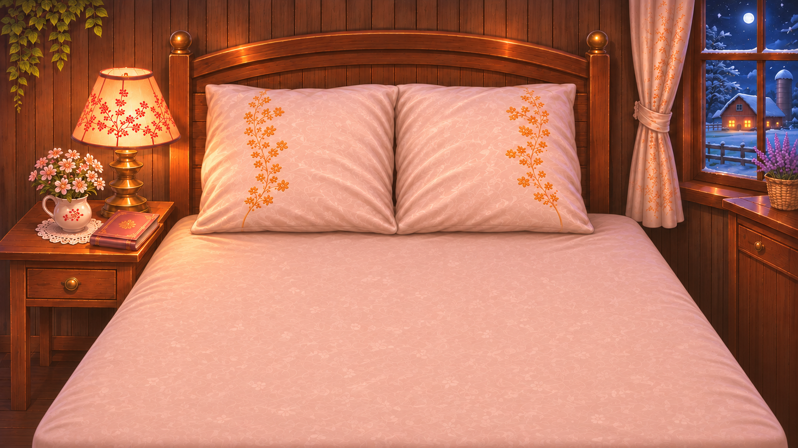

# Farm interiors: scene studies and character authoring

These three original, character-free environment illustrations establish a proposed shared look for married-life scenes: a solo armchair, two separate matching armchairs, and a close bedroom view. They are **candidates awaiting visual approval**. Earlier wide sofa and whole-bed studies remain historical; the revised direction calls for furniture and camera framing closer to the existing character splashes.

| Scene | Candidate | Native size | SHA-256 |
|---|---|---|---|
| Solo armchair · v002 | [PNG](../../../assets/farm-life/scene-studies/v002/solo-armchair.png) | 1672 × 941 | `9f6f007fa8530902b660a63aa169cfad0ee56de6917cb14d9bf5552959c1de92` |
| Dual armchairs · v002 | [PNG](../../../assets/farm-life/scene-studies/v002/dual-armchairs.png) | 1672 × 941 | `57bb9d044f251f691a1421ff260eca1848244585232a05ec671499acf9983645` |
| Bedroom · mattress correction v003 | [PNG](../../../assets/farm-life/scene-studies/v003/bedroom.png) | 1672 × 941 | `697271b46224b536e33395b333089e1a433b1d453d4c14fb228c7f3299c760a4` |

## Visual direction

The existing Farm night illustrations supply the starting language: softly shaded 2D anime, warm timber and cream plaster, floral linen, aged brass lamps, small domestic details and a cool night window. The new rooms share restrained rust, ivory, walnut and sage, warm illumination from viewer-left and cool window fill from viewer-right. Wood, stone and textiles have readable detail without photographic rendering.

Room redesign is allowed, with continuity in furnishings and camera language from the existing splashes. The current direction specifically prefers one-person upholstered armchairs, separate solo and duo compositions, and an intimate character-scene view. Once a room reference is selected, use it consistently for its later character studies.

The solo scene places the familiar rust-red, rolled-arm single chair near the center, with little exposed floor and a partial hearth on the left. The duo scene uses two separate matching chairs at equal scale and depth, mostly facing the viewer. The bedroom preserves the familiar arched headboard, floral pillows, lamp, bedside cabinets and night window in a closer, gently elevated view; the mattress continues through the lower crop. Its v003 correction replaces an overly inflated, wavy surface with a firmer level mattress under a thin fitted sheet. Winter night is the current lighting study; other seasons and story lighting can receive their own versions when requested.

## Scene purpose and posing

| Reference | Intended use | Pose guidance |
|---|---|---|
| Solo armchair | One-character conversation with the POV | Seated for the sitting beat; a standing arrival or farewell can use the space beside the chair |
| Dual armchairs | Shared conversation with two characters | Two seated characters on separate chairs, with readable faces mainly toward the viewer; duo selection remains an owner/story decision |
| Bedroom | Quiet bedside/resting and waking-up beats | Pillow-supported rest or a bed-edge seated shot when requested; maintain the familiar furniture and credible mattress support |

The existing approved set already mixes poses: pajama-by-window references stand, bed-edge scenes sit, and bed-rest scenes recline. There is no permanent per-character sitting or standing rule. Choose acting for the story beat and adjust framing around the approved character while keeping the selected room recognizable.

## Map a selected scene to a character study

1. Record the owner's selected room version and image hash. Keep earlier versions and their verdicts. A request to save or commit a candidate is distinct from visual approval.
2. Use the character's current approved Spring identity and approved full-body outfit as the authorities for her face, proportions, palette, hair, ears, accessories and garments. Author and review a new numbered outfit before its scene when needed.
3. Compose only the outfit-specific expression portrait needed for this scene from her approved base/face recipe. Preserve the dialogue pipeline's existing crop, masks and integer placements.
4. For the full illustration, provide her own full-body outfit and expression portrait as identity references, and the selected empty room as the environment reference. Label these roles explicitly in the exact saved prompt. The room supplies architecture, furnishings, viewpoint and lighting; it does not prescribe the character's clothing, body or personality.
5. Pose her for the story beat: seated in a chair, standing beside it, seated at the bed edge, or resting on pillows. Check supported weight, cushion or pillow compression, hand contact, integrated lighting on face/hair/body, clear space above both ears, garment visibility and a naturally occluded tail attachment. Keep useful seat or mattress surfaces visible. Framing can adapt to the acting without losing the room's recognizable design.
6. Save the full native scene, exact prompt, ordered reference roles/hashes and provenance in a private numbered study. Review the new image on its own. Generative scene reuse does not guarantee pixel-identical backgrounds; these plates do not introduce runtime character compositing.
7. Bind approval to the exact selected character scene. Update only affected derivatives when an outfit or scene changes, preserving all other approvals. Use the existing album builder when inclusion is requested.

The common room design leaves character outfits, personal details, expression and gesture open to individual art direction. The empty duo reference establishes two-chair staging; it does not select characters, author a duo event or mandate identical poses.

## Married-life slots and delivery

Use the existing `pajama-outfits`, `wedding-anniversary-outfits`, `pajama-splash` and `wedding-anniversary-splash` categories. Keep each character's numeric ID, collection, look number, outfit asset ID, matching splash asset ID and intended illustration scene ID together in the private handoff. Pajamas has ten looks including its baseline; anniversary has five. The scene style does not change their established unlock schedule.

The sitting beat can use the solo or dual armchair setting; bedside and morning beats can use the bedroom. A numbered story slot currently names one illustration scene ID, so these settings do not imply a separate required image for every dialogue beat. The wedding-day scene remains its own event. Numbered portrait resolution and category illustration delivery still require their planned game-integration mapping; no runtime or gallery wiring is introduced by these studies.

## Complete prompt and provenance handoff

Ignored `content/authoring/scene-studies/farm-life/married-life-interiors/purpose-and-prompts.md` contains the full exact submitted prompts for the solo chair, duo chairs, original close bedroom and mattress-correction edit. It also records each scene's purpose, input roles and SHA-256 values, image hash, prompt hash and version lineage. Individual `prompt.txt`, `inputs.json` and `generation.json` files remain beside every private image; `active-study.json` identifies the exact mixed-version selection. The mattress correction retains its first bedroom as a parent rather than replacing its history.

The committed PNGs are byte-for-byte native built-in image-generation outputs with no transforms. The exact-path Git exceptions cover the current and historical original environment files. Private character art, references, full prompts and source records retain their existing ignored storage rules.

Historical v001 studies: [wide sofa](../../../assets/farm-life/scene-studies/v001/fireplace-sofa.png) and [whole-bed room](../../../assets/farm-life/scene-studies/v001/bedroom.png). They are superseded for the current camera/furniture direction, with their files and provenance retained.

Next: obtain the owner's visual verdict on the three current room candidates, then apply the selected scene to the first requested character and outfit.
