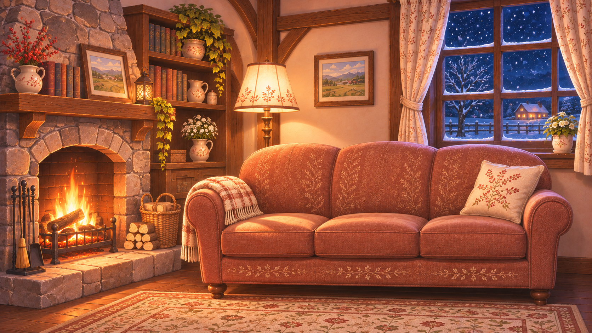
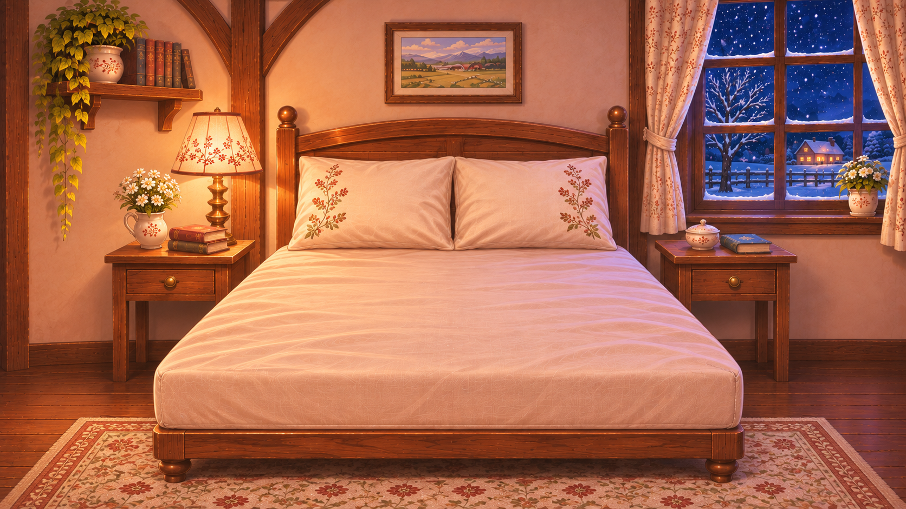

# Farm interiors: scene studies and character authoring

These two original, character-free environment illustrations establish a proposed shared look for married-life scenes. The owner requested both scenes and explicitly authorized committing their PNGs. They are **v001 candidates awaiting visual approval**, rather than an automatic replacement for existing approved character illustrations.

| Scene | Candidate | Native size | SHA-256 |
|---|---|---|---|
| Sofa beside the fireplace | [PNG](../../../assets/farm-life/scene-studies/v001/fireplace-sofa.png) | 1672 × 941 | `f74f048d36b02ae12a4131a30e53b3e38146d5203e46f97f9dbcb7c759528cf3` |
| Bedroom | [PNG](../../../assets/farm-life/scene-studies/v001/bedroom.png) | 1672 × 941 | `58b719a696f3a050e9f20d0431f8797d687ee40f460117c810acc4bee1f70064` |

## Visual direction

The existing Farm night illustrations supply the starting language: softly shaded 2D anime, warm timber and cream plaster, floral linen, aged brass lamps, small domestic details and a cool night window. The new rooms share restrained rust, ivory, walnut and sage, warm illumination from viewer-left and cool window fill from viewer-right. Wood, stone and textiles have readable detail without photographic rendering.

The owner clarified that redesigning the rooms is acceptable: earlier illustrations are visual references, not a requirement to reproduce every furniture item. Once a new room reference is selected, use it consistently for its later character studies.

The sofa scene uses a low, nearly frontal conversation viewpoint. A stone hearth and chimney sit on the left; the broad sofa, its seat edge and the floor in front are clear. The bedroom uses a gently elevated frontal viewpoint from the foot of the bed. Its arched headboard, pillows, mattress and bedside tables remain visible. A fitted sheet and pillows leave the bed surface open for later posing. Both rooms show a winter night as the initial lighting study; other seasons and story lighting can receive their own versions when requested.

## Map a selected scene to a character study

1. Record the owner's selected room version and image hash. Keep earlier versions and their verdicts. A request to save or commit a candidate is distinct from visual approval.
2. Use the character's current approved Spring identity and approved full-body outfit as the authorities for her face, proportions, palette, hair, ears, accessories and garments. Author and review a new numbered outfit before its scene when needed.
3. Compose only the outfit-specific expression portrait needed for this scene from her approved base/face recipe. Preserve the dialogue pipeline's existing crop, masks and integer placements.
4. For the full illustration, provide her own full-body outfit and expression portrait as identity references, and the selected empty room as the environment reference. Label these roles explicitly in the exact saved prompt. The room supplies architecture, furnishings, viewpoint and lighting; it does not prescribe the character's clothing, body or personality.
5. Repose her naturally into the seat or onto the bed. Check supported weight, cushion or pillow compression, hand contact, integrated lighting on face/hair/body, clear space above both ears, garment visibility and a naturally occluded tail attachment. Keep the useful sofa edge or mattress surface visible for the requested shot. Framing can adapt to the acting and story beat without losing the room's recognizable design.
6. Save the full native scene, exact prompt, ordered reference roles/hashes and provenance in a private numbered study. Review the new image on its own. Generative scene reuse does not guarantee pixel-identical backgrounds; these plates do not introduce runtime character compositing.
7. Bind approval to the exact selected character scene. Update only affected derivatives when an outfit or scene changes, preserving all other approvals. Use the existing album builder when inclusion is requested.

The common room design leaves character outfits, personal details, expression and gesture open to individual art direction. A duo composition is a separate requested study; the empty sofa and double bed merely provide usable staging space.

## Married-life slots and delivery

Use the existing `pajama-outfits`, `wedding-anniversary-outfits`, `pajama-splash` and `wedding-anniversary-splash` categories. Keep each character's numeric ID, collection, look number, outfit asset ID, matching splash asset ID and intended illustration scene ID together in the private handoff. Pajamas has ten looks including its baseline; anniversary has five. The scene style does not change their established unlock schedule.

The sitting beat can use the fireplace/sofa setting; bedside and morning beats can use the bedroom. A numbered story slot currently names one illustration scene ID, so these settings do not imply a separate required image for every dialogue beat. The wedding-day scene remains its own event. Numbered portrait resolution and category illustration delivery still require their planned game-integration mapping; no runtime or gallery wiring is introduced by these studies.

Exact generation prompts, reviewed private references, input hashes, tool source paths and study handoff live under ignored `content/authoring/scene-studies/farm-life/married-life-interiors/v001/`. The committed PNGs are byte-for-byte native built-in image-generation outputs with no transforms. The Git allowlist exception names only these two original environment files; private character art and reference collections retain their existing storage rules.

Next: obtain the owner's visual verdict on these two room candidates, then apply the selected scene to the first requested character and outfit.
